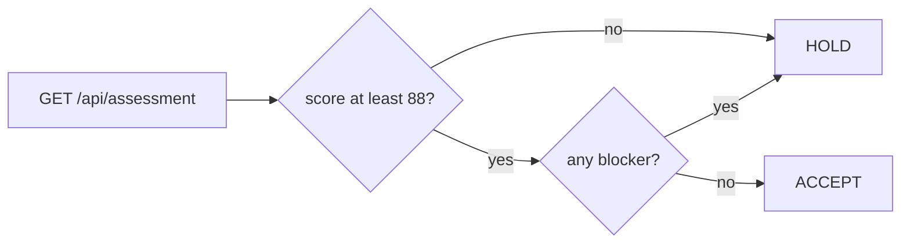

# Dashboard ruler, frame and stamp

## What it is
The Dashboard shows the SPRS score on a dimension-line ruler (-203 to 110, a red 88 line, a blue "YOU n" marker), a feature control frame (`SPRS | MEAS | LSL 88 | USL 110 | IN TOL or OUT OF TOL`), an inspector's stamp (HOLD or ACCEPT), the Conditional check, objective counts, families and a needs-attention list.

## How it works

- Blockers come from `packages/rules`: `poam_ineligible` blockers (barred or over 1 point), and `poam_missing` for each eligible Not Met requirement with no open POA&M item.
- Files: `apps/web/src/pages/dashboard/`, `apps/web/src/look/{DimensionRuler,FeatureControlFrame,InspectionStamp}.tsx`.
- Example: 72 with 3.1.20 Not Met shows +16 short, OUT OF TOL, HOLD and 11 blockers; 106 with 4 Not Met items each on an open POA&M shows IN TOL and ACCEPT.

## Why it's this way
- ACCEPT needs an open POA&M item per Not Met requirement because 32 CFR 170.24(c)(2)(i)(B)(6) requires it: [decisions.md](../decisions.md#2026-11-25--a-not-met-requirement-needs-an-open-poam-item-before-accept).
- The score uses C's ruler, not the caliper (human's choice).

## Watch out
- HOLD can show while the score is 88 or more, because of a blocker; the blockers are listed in text.
- "Today" is the UTC date, so countdowns can read a day off for US users in the evening: [decisions.md](../decisions.md#2026-11-25--today-is-the-utc-date-agent-default--override-anytime).

## History
- 2026-11-25 · plan cmmc-l2-grc · built (ssp-dashboard sprint, PRs #10 and #11) · [report](../reports/cmmc-l2-grc.html)
