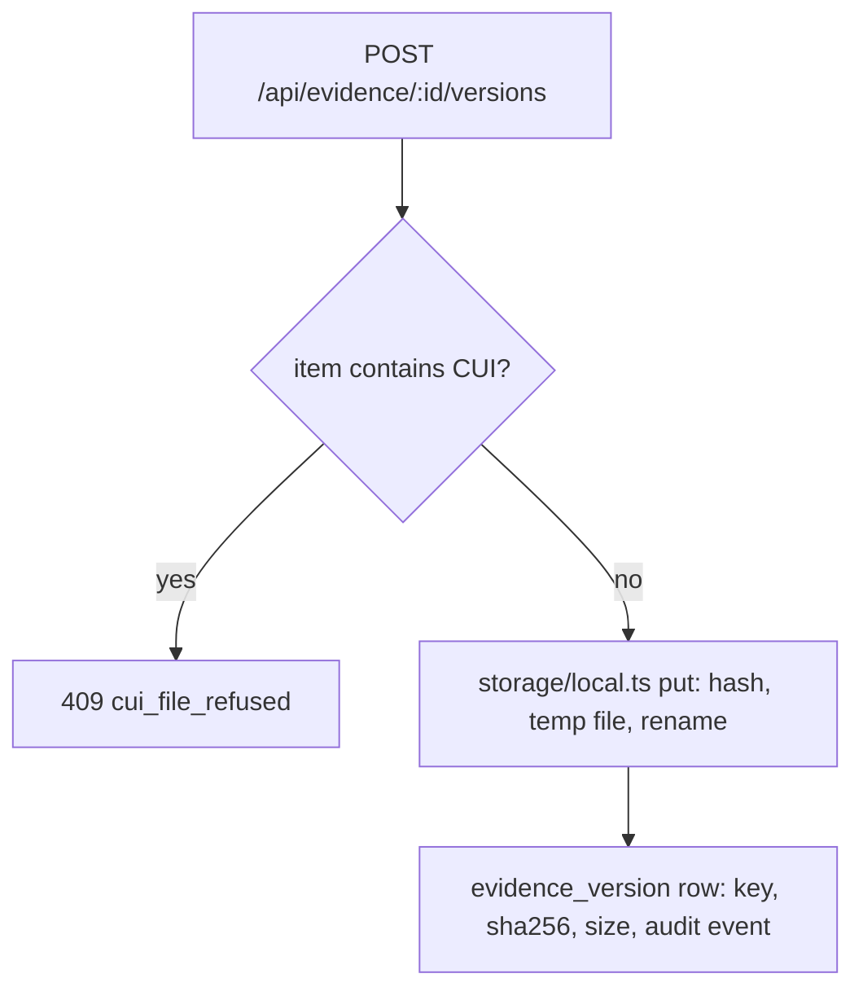

# Evidence upload and CUI refusal

## What it is
Evidence items linked to objectives. Each item holds file versions with a SHA-256, or, when flagged "contains CUI", only a reference to where the file really lives.

## How it works

- Uploads are a raw `application/octet-stream` body with the name in `x-file-name` (`uploads/upload.ts`).
- Files sit at `<STORAGE_PATH>/<first 2 hex>/<sha256>`, written to `tmp/` then renamed, so a reader never sees half a file. The database holds only key, hash, size and version.
- References (`POST .../references`) are accepted only on CUI-flagged items.
- Files: `apps/api/src/evidence/`, `apps/api/storage/`, `apps/web/src/pages/evidence/`.
- Example: the download is byte-identical, and the card shows the full 64-hex SHA-256.

## Why it's this way
- No real CUI in V1 (plan Key decisions); a banner says so. Storage sits behind the `FileStore` interface so a later plan can add encryption and an approved host.
- Content-addressed storage dedupes identical bytes.

## Watch out
- `containsCui` can't change after creation.
- A blank `STORAGE_PATH` is refused at startup.
- Hosting CUI needs FedRAMP Moderate equivalency (DFARS 252.204-7012); not done.

## History
- 2026-11-25 · plan cmmc-l2-grc · built (poam-evidence sprint, PRs #7 to #9) · [report](../reports/cmmc-l2-grc.html)
