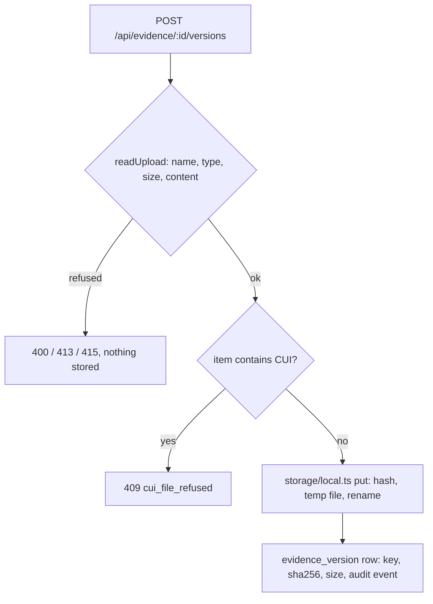

# Evidence upload and CUI refusal

## What it is
Evidence items linked to objectives. Each item holds file versions with a SHA-256, or, when flagged "contains CUI", only a reference to where the file really lives.

## How it works

- Uploads are a raw `application/octet-stream` body with the name in `x-file-name` (`uploads/upload.ts`).
- `readUpload` checks, in order: an octet-stream body (415), the name header (400), `sanitizeFileName` (bidi and zero-width characters removed, `< > : " | ? *` as `_`, a `_` before a Windows device name; nothing left gives 400), the extension (415 `unsupported_file_type`; only `.csv .docx .jpeg .jpg .pdf .png .txt .xlsx`), empty (400), size (413), then the content (415 `file_refused`, `uploads/file-check.ts`): the bytes must really be that type, .docx and .xlsx pass the zip guard (no macros, no encryption, at most 1,000 parts, 100 MiB and 100:1), and .txt/.csv must be UTF-8 text with no control characters or web markup. The sanitized name is what is stored, returned, downloaded and audited.
- The refusal's message is `fileRefusedMessage` (for a renamed program: "This file's contents aren't a real PDF file. It looks like a program."), and `details` carries `{ reason, extension, detected? }`. The web shows the message as it is.
- Files sit at `<STORAGE_PATH>/<first 2 hex>/<sha256>`, written to `tmp/` then renamed, so a reader never sees half a file. The database holds only key, hash, size and version.
- References (`POST .../references`) are accepted only on CUI-flagged items.
- Files: `apps/api/src/evidence/`, `apps/api/storage/`, `apps/web/src/pages/evidence/`.
- Example: the download is byte-identical, and the card shows the full 64-hex SHA-256.

## Why it's this way
- No real CUI in V1 (plan Key decisions); a banner says so. Storage sits behind the `FileStore` interface so a later plan can add encryption and an approved host.
- Content-addressed storage dedupes identical bytes.

## Watch out
- `containsCui` can't change after creation.
- A blank `STORAGE_PATH` is refused at startup.
- Hosting CUI needs FedRAMP Moderate equivalency (DFARS 252.204-7012); not done.
- The content check runs before the CUI check, so a fake file to a CUI item is 415 `file_refused`, not 409.
- Files stored before the guard are never re-checked: they still list, download byte-identical and link as diagrams. Tests seed them with `h.seedFileVersion`, since an upload of those bytes is refused now.
- The web's pre-check (`uploadProblem`) checks only the name and size; the content verdict comes from the api.

## History
- 2026-11-25 · plan cmmc-l2-grc · built (poam-evidence sprint, PRs #7 to #9) · [report](../reports/cmmc-l2-grc.html)
- 2026-11-27 · plan security-hardening · uploads checked by content: the allowed list narrowed to eight types, `file_refused`, the zip guard and sanitized names (sec-integrity sprint, U2)
- 2026-11-27 · plan security-hardening · plan complete: byte-based upload checks merged to main; a .txt starting <body><script> is still accepted (queued, someday) · [report](../reports/security-hardening.html) · [PR #45](https://github.com/haophn01/fun-thinking-rampart/pull/45)
