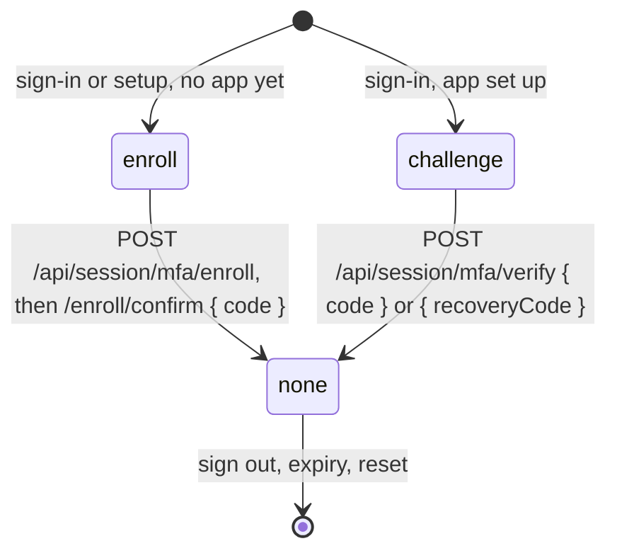

# Two-step sign-in (MFA)

## What it is
Every account signs in with its password and then a 6-digit code from an authenticator app (TOTP, RFC 6238: HMAC-SHA1, 30 s steps), or one of ten single-use recovery codes (3.5.3). An account without an app is shown **Set up two-step sign-in** straight after its password (a QR code and the key in groups of 4), confirms with the first code, and sees its recovery codes once. An admin can reset a user's two-step sign-in under Settings › Users; `pnpm admin:reset-mfa <email>` does the same on the machine when no admin can sign in.

**One-way door (sec-mfa A2):** since A2 merged, nobody reaches the app without the second step. Accounts from before it keep their password and enroll at their next sign-in, or at their next click if already signed in. Undo: `git revert -m 1 <A2 merge>`, then stop the app, run `node -e "const D=require('better-sqlite3');new D('data/rampart.sqlite').prepare('DELETE FROM session').run();console.log('sessions ended')"` in `apps/api`, and start it again, so no session that only passed the password becomes a full one. Stored secrets and codes stay sealed and unused.

## How it works

- **State:** `ActiveSession.mfa` (`auth/sessions.ts`) is read per request: `enroll` while the user has no `mfa_enrolled_at`, `challenge` while an enrolled user's session has `mfa_pending`, else `none`. Sign-in and setup create pending sessions; confirm and verify rotate to a new, not pending one (a new cookie and CSRF token). A pre-A2 session of an unenrolled user is marked pending on its next request, so enrolling in another tab or browser never turns it into a full session without a code.
- **Gate:** `auth/guard.ts` answers 403 `mfa_required` to any route outside `MFA_ROUTES` (lock, unlock and the three `/api/session/mfa/*` routes) while `mfa` isn't `none`. Order: 401, 403 `csrf_failed`, 423 `session_locked`, 403 `mfa_required`, 403 `password_change_required`, 403 `forbidden`, 400, 404. Public routes are never gated. The MFA routes are on `PASSWORD_CHANGE_ROUTES` too, so a temporary password's user enrolls first, then changes the password.
- **Routes** (`auth/mfa/routes.ts`): enroll answers the pending secret again on a re-show, so a reload keeps a QR already scanned; confirm enrolls at the matched step and stores 10 recovery-code hashes; verify checks body, state, account lock, code, then replay. Each step is accepted once per user (`mfa_last_step` moves only forward), each recovery code once. A wrong code at the challenge counts toward the 5-failure lockout; one at enrollment doesn't. `POST /api/users/:id/mfa/reset` (admin) and the CLI both call `resetMfa` (`auth/mfa/reset.ts`).
- **Secret key** (`security/secret-key.ts`, `security/secrets.ts`): `RAMPART_SECRET_KEY` (64 hex characters) wins when set; otherwise the key file at `SECRET_KEY_PATH` (default `data/rampart-secret.key`, resolved against `apps/api`) is read, or created on the first local start (mode 0600, never regenerated). Hosted mode refuses to start without the env var. HKDF derives one key for sealing secrets (AES-256-GCM, bound to `user:<id>`) and one for the recovery-code HMACs.
- **Web** (`apps/web/src/auth/`): `useSession()` adds `mfa_enroll`, `mfa_challenge` and `mfa_recovery_codes`; `MfaEnrollPage`, `RecoveryCodesPage` and `MfaChallengePage` sit in the auth frame. A 403 `mfa_required` from any call re-reads the session.
- Example: an admin signs in with the right password: "Enter your code"; the app's code opens the dashboard; the same code again on another sign-in is refused, "That code didn't work. Enter the newest code from your app."

## Why it's this way
- TOTP is built on `node:crypto`, not otplib (sprint decision in `pod-docs/sprints/sec-mfa.md`): otplib keeps no replay state anyway, and the e2e helpers import the same pure module.
- The state is computed, not stored, so an admin reset or a new enrollment applies on the very next request.
- No confirm step before a reset, as for password resets ([decisions.md](../decisions.md#2026-11-25--no-confirm-step-before-resetting-or-deactivating-yourself-agent-default--override-anytime)).

## Watch out
- **Back up the key with the database:** once users enroll, `apps/api/data/rampart-secret.key` (or `RAMPART_SECRET_KEY`) must be backed up with `rampart.sqlite`. Losing it orphans every MFA secret: verify answers 500 and every user needs a reset (`pnpm admin:reset-mfa <email>`). A key file that isn't a key stops the start instead of being replaced.
- **Scripts sign in in two steps.** In e2e, `e2e/helpers/api.ts` `signIn(request, email, password, { totpSecret })` finishes the step as the session asks: for `enroll` it enrolls and returns `totpSecret` and `recoveryCodes`; for `challenge` it verifies with `totpSecret`; `{ mfa: 'password_only' }` stops after the password. `setUp(request, admin)` is setup plus enrollment. `nextTotpCode(secret)` never sends a step twice (the current step, the next, or it waits); use it for codes typed in the browser too. `manualKey(text)` strips the spaces from `data-testid="mfa-manual-key"`.
- In api tests, `createHarness()`'s `setupAdmin()` and `signIn()` enroll with `HARNESS_MFA_SECRET` in the DB and leave a full session; `{ mfa: 'as_stored' }` leaves it as the api made it, and `h.totp(email)` gives the stored secret's code. Suites that drive `buildApp` directly use `signInThroughApi(app, url, payload, { at, secrets })` with `RAMPART_SECRET_KEY: HARNESS_SECRET_KEY` in their config, so a secret survives their restart.
- By hand: `POST /api/session` (with `noticeDigest` if a notice is set), then with the CSRF header `POST /api/session/mfa/enroll`, decode `secret` (base32) and `POST /api/session/mfa/enroll/confirm` `{ code }` with `totpAt(secret, now)` from `apps/api/src/auth/mfa/totp.ts`; later sign-ins `POST /api/session/mfa/verify` `{ code }` with a code of a step not used yet.
- Never log a code, secret, URI or recovery code: `REDACT_PATHS` covers `otpauthUri` and `recoveryCodes`, and `security/redaction.test.ts` runs every MFA flow at `trace`.

## History
- 2026-11-27 · plan security-hardening · contract, secret key, TOTP and QR (sec-mfa wave 1, PR #38); api, web screens and the users panel (wave 2, PR #39); required for every account, the gate and e2e (A2, wave 3)
