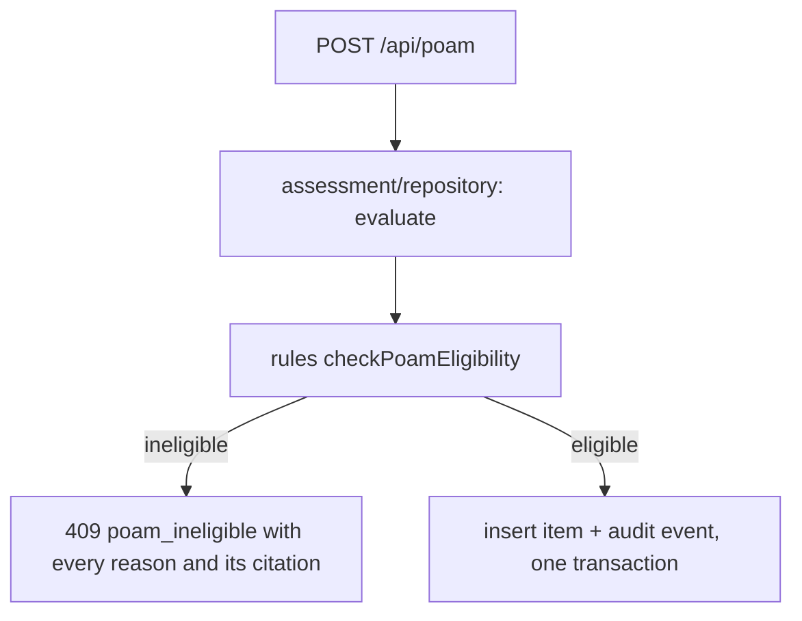

# POA&M create and refusal

## What it is
A plan of action and milestones for Not Met requirements. Items carry a plan, owner, due date and milestones, a 180-day closeout countdown from the Conditional Status Date, and an admin closeout.

## How it works

- Rules (`packages/rules/src/poam/eligibility.ts`, data in `regulation.ts`): the requirement must be Not Met; not one of the six barred (3.1.20, 3.1.22, 3.12.4, 3.10.3, 3.10.4, 3.10.5); worth 1 point or less, except 3.13.11 at the partial (-3) level.
- Closeout is due 180 days after the Conditional Status Date (32 CFR 170.21(b)); who confirms depends on the assessment type.
- Files: `apps/api/src/poam/{repository,routes}.ts`, `apps/web/src/pages/poam/`.
- Example: Add on AC.L2-3.1.20 is disabled with "can never go on a POA&M, 32 CFR 170.21(a)(2)(iii)".

## Why it's this way
- Every rule is data with a citation, so a regulatory change is a data edit plus a test (plan: built for continuous updates).
- The "item per Not Met" rule feeds the dashboard stamp: [decisions.md](../decisions.md#2026-11-25--a-not-met-requirement-needs-an-open-poam-item-before-accept).

## Watch out
- A closed item doesn't satisfy `poam_missing`.
- The milestone-change check in `PoamForm.tsx` compares JSON; it once used raw control bytes, which made git treat the file as binary (fixed in PR #14).

## History
- 2026-11-25 · plan cmmc-l2-grc · built (poam-evidence sprint, PRs #7 to #9) · [report](../reports/cmmc-l2-grc.html)
