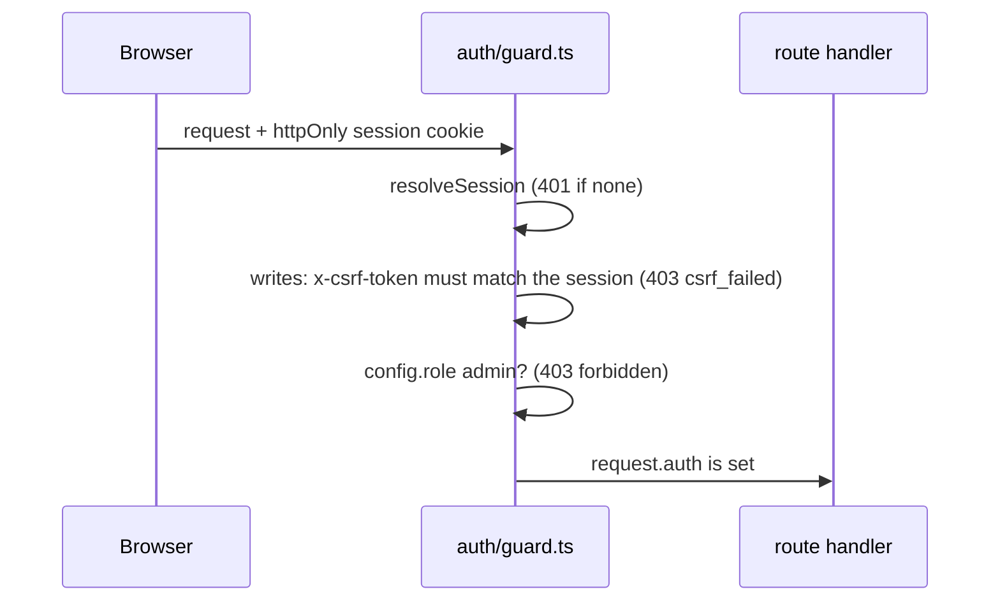

# Setup and sign-in

## What it is
Local email-and-password accounts. The first visit to an empty database shows **Set up Rampart** and creates the admin. After that, every API route except health, session status, setup and sign-in needs a session, and every write needs a CSRF token. Two roles: admin (users, settings, closeout) and contributor.

## How it works

- Deny by default: a route is public only with `config: { public: true }`; setup and sign-in set `skipCsrf` because no session exists yet.
- Passwords are Argon2id hashes (`auth/password.ts`). An unknown email is verified against a dummy hash so timing doesn't reveal accounts.
- Files: `apps/api/src/auth/{guard,sessions,password,routes}.ts`, `apps/web/src/auth/`.
- Example: wrong password gives 401 "Email or password is incorrect."; repeated failures lock the account for 15 minutes.

## Why it's this way
- Server sessions with an httpOnly SameSite cookie, not tokens in JS: the page can't read the cookie (`document.cookie` stays empty).
- A deactivated account's sign-in never counts a failure, so a 429 can't reveal that it exists. Human accepted this default.
- An admin password reset also clears the lockout; resetting or deactivating yourself ends all your sessions. Both accepted by the human. No confirm dialog: [decisions.md](../decisions.md#2026-11-25--no-confirm-step-before-resetting-or-deactivating-yourself-agent-default--override-anytime).

## Watch out
- Turning sign-in on was a one-way door (PR #5); revert its merge to undo.
- The API logger redacts cookie, authorization and `x-csrf-token`.
- Add new routes inside `registerApiRoutes`, or they skip the guard.

## History
- 2026-11-25 · plan cmmc-l2-grc · built (assessment sprint, PR #5) · [report](../reports/cmmc-l2-grc.html)
