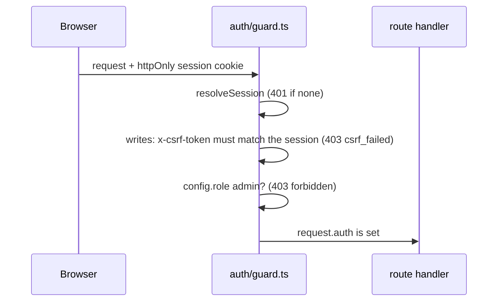

# Setup and sign-in

## What it is
Local email-and-password accounts. The first visit to an empty database shows **Set up Rampart** and creates the admin. After that, every API route except health, session status, setup and sign-in needs a session, and every write needs a CSRF token. Two roles: admin (users, settings, closeout) and contributor.

## How it works

- Deny by default: a route is public only with `config: { public: true }`; setup and sign-in set `skipCsrf` because no session exists yet.
- Passwords are Argon2id hashes (`auth/password.ts`). An unknown email is verified against a dummy hash so timing doesn't reveal accounts.
- Files: `apps/api/src/auth/{guard,sessions,password,routes}.ts`, `apps/web/src/auth/`.
- The cookie: only `auth/cookie.ts` names or sets it. Locally it is `rampart_session` (`HttpOnly; SameSite=Strict; Path=/`, no `Secure`, since the app is plain http on 127.0.0.1). With `HOSTED=true` it is `__Host-rampart_session` with `HttpOnly; Secure; SameSite=Strict; Path=/` and no `Domain`, so no other host can set or shadow it; each mode reads only its own name. Hosted responses also carry HSTS (`max-age=31536000; includeSubDomains`).
- Rate limits, before the guard (a flood gets 429, never 401, and never reaches the database): `POST /api/setup` and `POST /api/session` each allow 10 requests a minute per IP, in buckets of their own; everything else shares 600 a minute per IP. Over the limit: 429 `too_many_attempts` with `details.retryAfterSeconds` and `Retry-After`; the sign-in page shows "Too many attempts. Try again in N minutes." `RATE_LIMIT_MULTIPLIER` scales both (tests and e2e only; hosted mode needs 1). The 5-failure, 15-minute account lockout is separate and unchanged.
- Example: wrong password gives 401 "Email or password is incorrect."; repeated failures lock the account for 15 minutes.

## Why it's this way
- Server sessions with an httpOnly SameSite cookie, not tokens in JS: the page can't read the cookie (`document.cookie` stays empty).
- A deactivated account's sign-in never counts a failure, so a 429 can't reveal that it exists. Human accepted this default.
- An admin password reset also clears the lockout; resetting or deactivating yourself ends all your sessions. Both accepted by the human. No confirm dialog: [decisions.md](../decisions.md#2026-11-25--no-confirm-step-before-resetting-or-deactivating-yourself-agent-default--override-anytime).

## Watch out
- Turning sign-in on was a one-way door (PR #5); revert its merge to undo.
- The API logger redacts cookie, authorization and `x-csrf-token`.
- Add new routes inside `registerApiRoutes`, or they skip the guard.
- A browser keeps a `__Host-` cookie only over TLS, so hosted mode can't be signed into over plain http: test it with a request client reading `Set-Cookie` (as `e2e/security.spec.ts` does), or behind the TLS proxy.
- Rate limits key on `request.ip`. Hosted, `X-Forwarded-For` is trusted only from 127.0.0.1 (the one local proxy); a proxy elsewhere would put every user in one bucket.
- Scripts or specs that sign in many times locally need `RATE_LIMIT_MULTIPLIER` raised, or they get 429s.

## History
- 2026-11-25 · plan cmmc-l2-grc · built (assessment sprint, PR #5) · [report](../reports/cmmc-l2-grc.html)
- 2026-11-26 · plan security-hardening · hosted `__Host-` Secure cookie, HSTS, rate limits on setup and sign-in (sec-baseline sprint, PRs #28 and #30); checked end to end on the production path by `e2e/security.spec.ts`
