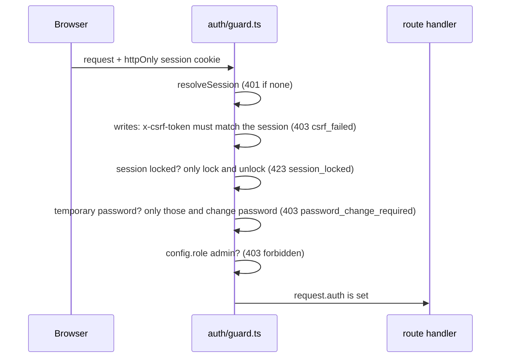

# Setup and sign-in

## What it is
Local email-and-password accounts. The first visit to an empty database shows **Set up Rampart** and creates the admin. After that, every API route except health, session status, setup, sign-in and sign-out needs a session, and every write needs a CSRF token. Two roles: admin (users, settings, closeout) and contributor. Sessions end after 30 minutes idle or 8 hours in all, the app locks after 15 minutes without input (3.1.10), an admin-set password must be changed at first sign-in, new passwords are checked against a common-password list and the last five, and an admin can require every sign-in to acknowledge a system use notice (3.1.9).

## How it works

- Deny by default: a route is public only with `config: { public: true }`; setup and sign-in set `skipCsrf` because no session exists yet.
- Passwords are Argon2id hashes (`auth/password.ts`). An unknown email is verified against a dummy hash so timing doesn't reveal accounts.
- Files: `apps/api/src/auth/{guard,sessions,password,routes}.ts`, `apps/web/src/auth/`.
- The cookie: only `auth/cookie.ts` names or sets it. Locally it is `rampart_session` (`HttpOnly; SameSite=Strict; Path=/`, no `Secure`, since the app is plain http on 127.0.0.1). With `HOSTED=true` it is `__Host-rampart_session` with `HttpOnly; Secure; SameSite=Strict; Path=/` and no `Domain`, so no other host can set or shadow it; each mode reads only its own name. Hosted responses also carry HSTS (`max-age=31536000; includeSubDomains`).
- Rate limits, before the guard (a flood gets 429, never 401, and never reaches the database): `POST /api/setup`, `POST /api/session`, `POST /api/session/password` and `POST /api/session/unlock` each allow 10 requests a minute per IP, in buckets of their own; everything else shares 600 a minute per IP. Over the limit: 429 `too_many_attempts` with `details.retryAfterSeconds` and `Retry-After`; the sign-in page shows "Too many attempts. Try again in N minutes." `RATE_LIMIT_MULTIPLIER` scales both (tests and e2e only; hosted mode needs 1). The 5-failure, 15-minute account lockout is separate and unchanged.
- Example: wrong password gives 401 "Email or password is incorrect."; repeated failures lock the account for 15 minutes.
- **Session limits:** 30 minutes after the last request (`last_seen_at`) or 8 hours after sign-in (`created_at`), ending at exactly the limit; the cookie's `Max-Age` is 28800. A password change rotates the session (new token and CSRF token, same `created_at`) and ends the user's other sessions.
- **Lock (3.1.10):** the web app's `IdleLock` locks after 15 minutes without keyboard, pointer, wheel or touch input in any tab (`localStorage['rampart.lastInputAt']`), shows the lock screen at once and posts `POST /api/session/lock` (204; `session.locked_at`, audited "Session locked" once). The app stays mounted behind it, `hidden` and `inert`, so drafts survive. While locked the api answers 423 to everything but lock, unlock and public routes, and `last_seen_at` stands still. `POST /api/session/unlock` `{ password }` answers 200 (audited "Session unlocked") or 401, shown as "Password is incorrect."; it doesn't rotate the cookie, since tabs share it. Input sends a keep-alive (`GET /api/session`) at most every 5 minutes.
- **Passwords:** on setup, a change and an admin's temporary password, `auth/password-policy.ts` refuses anything on the bundled offline list (`auth/blocklist/`, about 46,000 entries, case-insensitive) with `password_too_common`; a change also refuses the current password and the newest 4 in `password_history` (`password_reused`). Sign-in never applies them. Change order: body, account lock (429), current password, blocklist, reuse. Audited "Password changed" with no before or after.
- **Temporary passwords:** adding a user or resetting a password sets `must_change_password`; that user's sessions then reach only lock, unlock and `POST /api/session/password`, and the web app shows the forced Change password page in the auth frame. A reset or a real role change ends all the target's sessions.
- **Lockout:** sign-in, unlock and change share one run of 5 failures (`auth/lockout.ts`). If the 5th comes from a session, the same transaction locks the account and ends all the user's sessions (401 `unauthenticated`).
- **Sign-in notice (3.1.9):** one row in `settings`, set by an admin under Settings › Sign-in notice (`PUT /api/settings/sign-in-notice`, audited "Settings changed"). `GET /api/session` sends `{ text, digest }` to everyone; sign-in needs `noticeDigest` equal to the digest (the SHA-256 hex of the stored text), or 400 `notice_not_acknowledged` with no failure counted. A successful sign-in writes "Sign-in notice acknowledged" (`after: { digest }`) before "Signed in", in its transaction. Setup is never gated. Example: an admin saves the notice; the next sign-in shows it and **Acknowledge and continue**, then the form.

## Why it's this way
- Server sessions with an httpOnly SameSite cookie, not tokens in JS: the page can't read the cookie (`document.cookie` stays empty).
- A deactivated account's sign-in never counts a failure, so a 429 can't reveal that it exists. Human accepted this default.
- An admin password reset also clears the lockout; resetting or deactivating yourself ends all your sessions. Both accepted by the human. No confirm dialog: [decisions.md](../decisions.md#2026-11-25--no-confirm-step-before-resetting-or-deactivating-yourself-agent-default--override-anytime).

## Watch out
- Turning sign-in on was a one-way door (PR #5); revert its merge to undo.
- The API logger redacts cookie, authorization and `x-csrf-token`.
- Add new routes inside `registerApiRoutes`, or they skip the guard.
- A browser keeps a `__Host-` cookie only over TLS, so hosted mode can't be signed into over plain http: test it with a request client reading `Set-Cookie` (as `e2e/security.spec.ts` does), or behind the TLS proxy.
- Rate limits key on `request.ip`. Hosted, `X-Forwarded-For` is trusted only from 127.0.0.1 (the one local proxy); a proxy elsewhere would put every user in one bucket.
- Scripts or specs that sign in many times locally need `RATE_LIMIT_MULTIPLIER` raised, or they get 429s.
- A user an admin creates can't use the app until they change the password: specs that sign in as one go through the change, or use the harness's `signIn`, which clears the flag (`{ temporary: true }` keeps it). The look spec's seeded `cole@example.test` is flagged.
- With a notice set, every scripted sign-in needs the digest: `e2e/helpers/api.ts`'s `signIn` reads it from `GET /api/session`.
- Don't wait 15 minutes for the lock in a check: post `POST /api/session/lock`, or use Playwright's `page.clock` (as `e2e/auth.spec.ts` does).
- Pick test passwords off the blocklist: `PassWord1234` and one character repeated 12 times are on it.

## History
- 2026-11-25 · plan cmmc-l2-grc · built (assessment sprint, PR #5) · [report](../reports/cmmc-l2-grc.html)
- 2026-11-26 · plan security-hardening · hosted `__Host-` Secure cookie, HSTS, rate limits on setup and sign-in (sec-baseline sprint, PRs #28 and #30); checked end to end on the production path by `e2e/security.spec.ts`
- 2026-11-26 · plan security-hardening · 30 min / 8 h sessions, session lock, password blocklist and history, temporary passwords, sign-in notice (sec-auth sprint, PRs #33 to #35); driven end to end by `e2e/auth.spec.ts`, the screens measured by `e2e/look.spec.ts`, and the logs checked for secrets over the new flows
