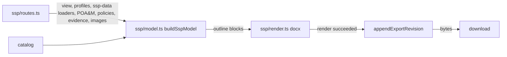

# SSP export

## What it is
**SSP** › Lint & export › Export SSP (.docx), or `GET /api/ssp/export`, downloads the System Security Plan as a Word document named `SSP-<identifier>-<UTC date>.docx`. Version 2 follows the NIST SP 800-171 SSP outline with the CMMC sections, embeds up to 10 diagrams, ends with signature lines and two appendices, and records each export in the SSP's record of changes.

## How it works

- **The outline** (`buildSspModel`, pure; one file per group of sections in `ssp/model/`): the title block, then ten level-1 headings in this order: "1. System identification" (with "1.1 Roles and users" and the user totals), "2. System environment" (with "2.1 Diagrams"), "CMMC: CUI description", "CMMC: Asset inventory" (one table per asset category), "CMMC: External service providers and responsibilities" (providers, then the matrix rows that have a party), "3. Requirements" (each with `Status: <NIST status>`, points, owner, current and planned implementation, N/A rationale, policies, evidence and open POA&M item), "4. Record of changes", "Approvals" (a signature block each), "Appendix A — Assessment status" (versions, the SPRS line, Conditional status, counts by NIST status, the POA&M) and "Appendix B — Assessment objectives" (all 320, one table per family).
- **Diagrams:** a link is embedded only when it is marked embeddable (its stored bytes read as PNG or JPEG, not just its file name), its item isn't flagged CUI, it is among the first `SSP_MAX_EMBEDDED_IMAGES` (10) such links, its bytes read (hash-checked) and `imageInfo` reads its size. An embedded one gets "Figure <n>. <caption> — <kind>, <title> v<version>, <file>, SHA-256 <hash>, <date>". Anything else is a reference line: the file name and SHA-256 for a file, "contains CUI, kept at <location>" for a CUI reference, or "no version recorded yet".
- **Record of changes:** the route sets this export's own entry (`<UTC today> | Exported as <file name> | <exporter's display name>`), renders with it as the table's last row, and only after the render succeeds appends the same entry as an `export` revision (one `ssp_revision.created` audit event) in one transaction, then sends the bytes. So the document's last row is also the last revision in `GET /api/ssp/document-control`.
- `render.ts` is deterministic: without images `document.xml` is identical every time; with images only media and relationship ids differ. `ssp/testing/docx-text.ts` reads a `.docx` back (one line per paragraph, each table cell its own line; `docxMedia` lists `word/media/*`); `e2e/helpers/docx.ts` re-exports it.
- Example: `e2e/smoke.spec.ts` › SSP v2 export links a PNG (network), a PDF (other) and the CUI item (data flow), and finds exactly one media part and one `<w:drawing>`, the PDF reference line with its SHA-256, the CUI item as `contains CUI, kept at \\enclave-fs01\cui\network-diagram.vsdx`, and a final row "<today> | Exported as SSP-CEE-01-<today>.docx | Ada Admin".

## Why it's this way
- The NIST SP 800-171 SSP template's section numbers are what assessors expect; the CMMC sections (32 CFR 170.19 asset categories, ESP responsibilities) sit around them, unnumbered.
- A CUI file never leaves the enclave in the export, even if a link arrives marked embeddable: `mayEmbed` checks the flag again.
- The revision is written after the render, so a failed export (500) leaves no record; a cross-site GET can't trigger one, since the session cookie is `SameSite=Strict`.
- Outline and renderer stay separate, so a later OSCAL export can reuse the outline.

## Watch out
- Every export writes a revision, so the record of changes grows by one per download, including test downloads.
- An image whose bytes can't be read is referenced ("the image couldn't be read") with a warning in the log naming the link id; the export still answers 200.
- The pre-export check ([ssp-lint](ssp-lint.md)) never blocks the export.
- The objectives table moved from section 3 to Appendix B; section 3 still holds every requirement's status and statement (`e2e/smoke.spec.ts` › SSP export contents).
- A GIF saved as `fake.png` is not embeddable: it is referenced and uses no embed slot. If a file can't be read at check time it keeps the file name's verdict, and the export then says it couldn't be read.
- A label can orphan from its table: fixed with keep-with-next (S3).

## History
- 2026-11-25 · plan cmmc-l2-grc · built (ssp-dashboard sprint, PR #11) · [report](../reports/cmmc-l2-grc.html)
- 2026-11-25 · plan ssp-export-v2 · v2 outline, diagrams, signature lines and appendices (X2, PR #20); the export's record-of-changes entry (A12, PR #21); e2e and docs (E4)
- 2026-11-26 · plan ssp-export-v2 · embeddable decided from the image bytes (review fix, PRs #24 and #25) · [report](../reports/ssp-export-v2.html)
