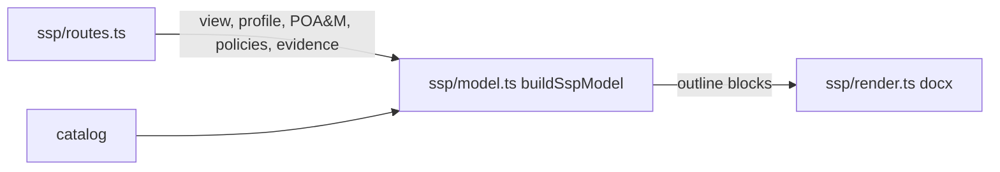

# SSP export

## What it is
**SSP** > Export SSP (.docx), or `GET /api/ssp/export`, downloads the System Security Plan as a Word document named `SSP-<identifier>-<UTC date>.docx`.

## How it works

- `buildSspModel` is a pure outline with four sections: 1 System characteristics, 2 Assessment summary (SPRS score), 3 Security requirements (each with `Status:` and its implementation statement, owner, linked policies and evidence), 4 Plan of action and milestones.
- `render.ts` turns the outline into a deterministic `.docx`; `ssp/testing/docx-text.ts` reads one back as text for tests.
- Example: the export contains "SPRS 108 / 110", 110 `Status:` lines, and `&` and `<` intact.

## Why it's this way
- The outline follows the OSCAL SSP section shape. There is no official template; comparing against templates is queued as research.
- Outline and renderer are separate so a later OSCAL export reuses the outline.

## Watch out
- A requirement with no statement reads "Not provided"; 3.12.4 (the SSP) is a prerequisite and has no points.
- The export was opened in Word once by an engineer (31 pages); the reviewer did not.
- A label can orphan from its table: fixed with keep-with-next (S3).

## History
- 2026-11-25 · plan cmmc-l2-grc · built (ssp-dashboard sprint, PR #11) · [report](../reports/cmmc-l2-grc.html)
