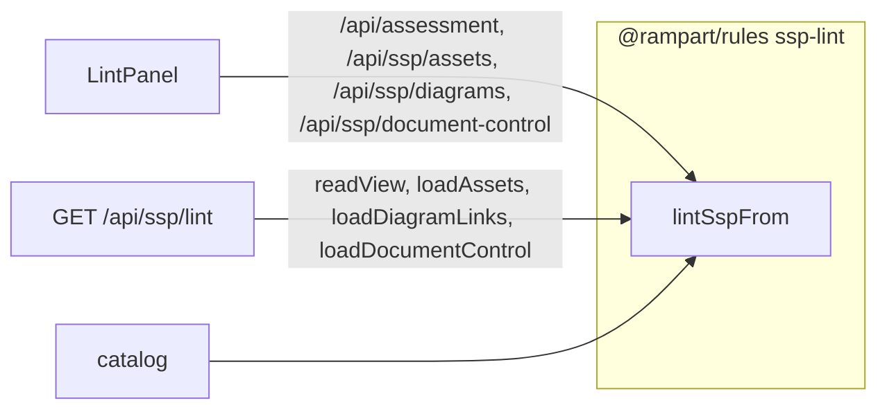

# Pre-export check (SSP lint)

## What it is
**SSP** › Lint & export (`/ssp?tab=export`), section 2 "Pre-export check", lists what an assessor would flag in the SSP before you export it: errors (the SSP requirement isn't Met, no assets, no network diagram, review overdue, empty statements, Not Met without a POA&M item) and warnings (N/A without a rationale, future-tense statements, SSP and POA&M disagree, large images, images over the embed limit). `GET /api/ssp/lint` returns the same findings with their counts. The check only warns: the export link is always enabled.

## How it works

- `lintSspFrom(catalog, { view, assets, diagrams, review }, { maxEmbeddedImages, largeImageBytes })` in `packages/rules/src/ssp-lint/` is pure. The web panel and the api call it with the same four inputs and the same limits (`SSP_MAX_EMBEDDED_IMAGES = 10`, `SSP_LARGE_IMAGE_BYTES = 5 MiB` from the contract), so the panel's summary equals the api's `counts`.
- Twelve rules in a fixed order (`SSP_LINT_RULES`, with each rule's label and hint); findings come in rule order, then catalog order for requirements and input order for assets and diagrams. The rule table is in `packages/rules/README.md`.
- Future tense: `FUTURE_TENSE_TERMS` (`will`, `plan to`, `planned`, `intend`, `going to`, `to be implemented`, `TBD`), case-insensitive on word boundaries. Only the implementation statement is checked, never Planned implementation.
- The panel loads its four reads on the tab's first visit and shows "<e> error(s) · <w> warning(s)" (or "No findings. Every check passes."), then one Alert per rule that fired, titled "<label> · <count>": error tone for errors, info for warnings. Each message is a list item; a requirement finding links "Open <id>" to `/assessment?family=<family>&req=<id>`, and asset, diagram and review rules link to their tab. After 10 messages, "Show all <n>" reveals the rest. "Check again" re-requests all four reads.
- `GET /api/ssp/lint` writes nothing: signed out gives 401, no assessment 404.
- Example: a statement "AC.L2-3.1.2 will be met once MFA is rolled out; the date is TBD." gives the warning `AC.L2-3.1.2 says "will", "TBD" (future tense).`; a next review date 2 days ago gives the error "The SSP review was due <date>, 2 days ago."

## Why it's this way
- One pure function for both sides, so the live panel can't drift from the api, and `e2e/smoke.spec.ts` compares the two in the browser.
- Findings warn but never block: an SSP is a living document, and a contractor may need to export a draft.
- The contract mirror (`apps/api/src/contract/ssp-lint.ts`) is zod-only and never imports `@rampart/rules`; `contract-rules-types.test.ts` checks the two infer to the same types.

## Watch out
- When `openPoamRequirementIds` is missing from the view, rules 7 and 10 are skipped, as the Conditional check does.
- The api refuses an out-of-scope asset without a justification, so rule 3 only fires in a fixture.
- While it runs, the panel says "Running the pre-export check…", which doesn't start with "Loading": `e2e/look.spec.ts` waits for a finding on the export tab before it measures.
- `e2e/look.spec.ts` seeds a future-tense statement and checks its finding on the export tab; `e2e/smoke.spec.ts` › lint panel matches the api compares every group with `GET /api/ssp/lint`.

## History
- 2026-11-25 · plan ssp-export-v2 · built (ssp-export-lint sprint: rules L5 and api A12 in PRs #20 and #21, panel W17 in PR #21; e2e and docs in E4)
