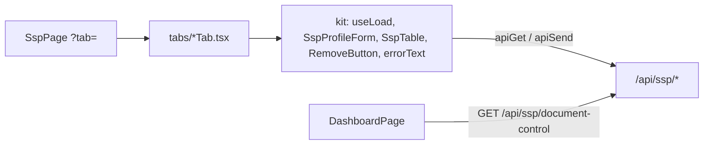

# SSP workspace

## What it is
**SSP** (`/ssp`) is one page with six tabs, one per part of the v2 SSP. Each tab fills a part of the SSP data api (`/api/ssp/*`), and both roles edit everything except approvals, which only admins change.

| `?tab=` | Tab | What it holds |
|---|---|---|
| `identification` | Identification & roles | 1 the system profile form, 2 identification fields (categorization, security officer, address, phone), 3 system roles with "<users> users · <privileged> privileged" |
| `environment` | Environment | 1 CUI description, 2 system environment narratives, 3 diagrams linked from evidence items |
| `assets` | Assets | the asset inventory, one table per CMMC asset category |
| `providers` | Service providers & matrix | 1 service providers, 2 the responsibility matrix (110 rows under family headings) |
| `document-control` | Document control | 1 review status and schedule, 2 record of changes, 3 approvals |
| `export` | Lint & export | 1 readiness, 2 "Export SSP (.docx)" |

## How it works

- Tabs: `SSP_TABS` in `pages/ssp/tabs.ts`. No `tab`, or an unknown one, selects Identification and leaves the URL alone. Clicking a tab pushes `?tab=<id>`, so Back returns to the previous tab; arrow keys wrap, Home/End jump.
- A tab's panel mounts on its first visit and then stays mounted, hidden, so an unsaved draft survives a tab switch; an unvisited tab sends no request.
- The SSP profile's fields (`SSP_PROFILE_FIELDS`) are split by group across tabs: `identification` on Identification, `cui` and `environment` on Environment, `review` on Document control. `SspProfileForm` PATCHes `/api/ssp/profile` with only the changed keys; blank text sends `null`.
- Collections (roles, assets, diagrams, providers, approvals) share one create/edit form each; edit PATCHes only changed keys, Remove asks "Remove <name>?" first, and every write reloads the list so totals and order are the server's.
- Diagrams link an evidence item: "Embedded image" for a PNG or JPEG that isn't CUI, "Referenced — contains CUI" for a CUI item, else "Referenced".
- The matrix PUTs `{ party, providerId, note }` to `/api/ssp/responsibilities/<requirement ID>`; ESP and Shared need a provider, Organization and Not set clear it.
- Review overdue: when `GET /api/ssp/document-control` says `reviewOverdue`, Document control shows an error Alert "Review overdue" and the dashboard's Needs attention adds "SSP review overdue: due <date> · <n> day(s) overdue", linking to `/ssp?tab=document-control`.
- The requirement detail on **Assessment** adds "SSP status", "Planned implementation" and "N/A rationale" below the implementation statement.
- Example: with a next review date 5 days ago, the dashboard shows "SSP review overdue: due <that date> · 5 days overdue"; a role of 2 privileged users and one of 12 others reads "14 users · 2 privileged".

## Why it's this way
- One route with `?tab=` keeps the nav, `APP_ROUTES` and the Shell tests unchanged while giving each SSP part a linkable URL.
- Tabs stay mounted after their first visit so switching tabs never drops typing.
- Every table is an `SspTable`, so each one stacks into labelled cards on phones (`max-width: 767px`) the same way.

## Watch out
- Every tab's loading text starts with "Loading": `e2e/look.spec.ts` waits for it to go before it measures a page. A new tab or section must keep that.
- "Today" for revision and approval dates, and for the review countdown, is the UTC date.
- A provider named on matrix rows can't be removed (409 `provider_in_use`); point those rows elsewhere first.
- Two profile forms sit on Identification & roles on two routes (`/api/system-profile` and `/api/ssp/profile`); see [system profile](system-profile.md).
- `e2e/look.spec.ts` seeds every tab and checks each `/ssp?tab=<id>` at 1280 and 375 px; a new tab needs a seed row and appears there through `SSP_TABS`.

## History
- 2026-11-25 · plan ssp-export-v2 · built (ssp-workspace sprint, PRs #17 and #18; look spec and docs in E3)
