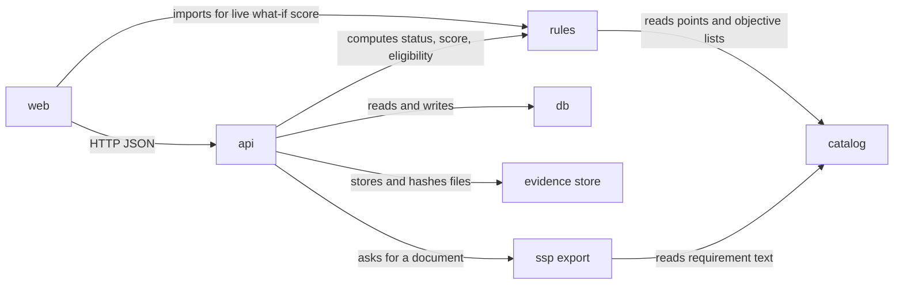
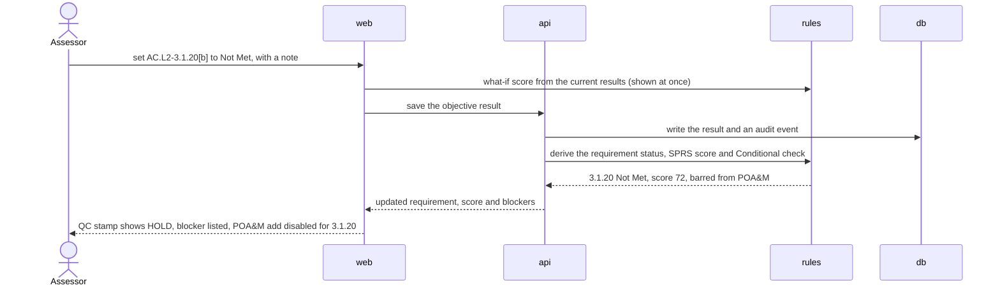
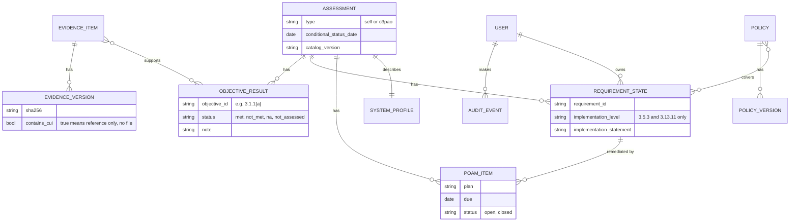

# Plan: CMMC L2 readiness platform (V1, workflow first)

_Generated: 2026-11-23 · Status: active · Grilled-with: pod_

Port base: 3000
<!-- autopilot-run: started=2026-11-23T22:30:00-08:00 sprints=0 waves=0 -->

## Goal
Build "Rampart" (a placeholder name), a self-hosted CMMC Level 2 readiness platform that one defense contractor runs locally to prepare for a self-assessment or a C3PAO assessment. You assess each of the 320 NIST SP 800-171A (Rev 2) objectives. The platform derives requirement status from them, a live SPRS score, a Conditional-status check and a rules-checked POA&M, and it manages evidence and policies and generates the SSP as a Word document.

## Why
- The research ([cmmc-l2-grc](../research/cmmc-l2-grc.md)) found no tool that tracks the 320 objectives as first-class records:
  - The SOC 2-origin platforms add CMMC on top and need configuration to show SPRS.
  - The MSP tools are built for the wrong customer.
  - SaaS vendors avoid storing CUI.
  - The only open-source tracker (clucraft/cmmc) is a small project that tracks controls only.
- **Success:** a compliance lead can go from an empty install to an assessed baseline with:
  - a correct SPRS score
  - a POA&M that the 32 CFR 170.21 rules accept or reject
  - evidence and policies linked to objectives
  - an exported SSP .docx
  
  All of it runs on a Windows dev machine with no external services.
- **Constraints:**
  - Correctness of the scoring and POA&M rules matters more than breadth. Every rule cites its source and has table-driven tests.
  - No real CUI in V1 (see Key decisions).

## Scope
**In scope:**
- Monorepo bootstrap with GitHub Actions CI: clean install, typecheck, tests, secret scan.
- Versioned NIST 800-171 Rev 2 / 800-171A catalog (14 families, 110 requirements, 320 objectives, point values) as a data file with count tests.
- A shared rules package that derives:
  - requirement status from objective results
  - the SPRS score, including partial credit for 3.5.3 and 3.13.11
  - POA&M eligibility
  - Conditional-status checks
  - the 180-day closeout clock
- Local accounts (admin and contributor), owner assignment, and an audit log of every status and content change.
- Assessment workspace: browse families and requirements, set Met / Not Met / N/A per objective with notes, and write implementation statements.
- Live SPRS score plus what-if mode, which tries status changes without saving them.
- Assessment settings: self-assessment or C3PAO certification, and the Conditional Status Date.
- POA&M: items only for Not Met requirements, eligibility enforced by the rules, plan, milestones, owner, due dates, 180-day countdown, and closeout.
- Evidence: upload with versions and SHA-256, link to objectives, and a "contains CUI" flag. A flagged item can't hold a file; it stores a reference instead.
- Policies: upload documents, keep versions, and link them to requirements.
- System profile (SSP system characteristics) and SSP export as .docx.
- Readiness dashboard (score, QC stamp, Conditional check, objective status, families, needs-attention list).

**Out of scope (next plans, in order):**
- OSCAL export of the SSP and POA&M, validated with compliance-trestle.
- Integrations that pull evidence (M365 GCC High / Entra, AWS GovCloud, endpoint tools), plus SSO.
- Encrypted CUI evidence storage, hosting, and backups.
- NIST 800-171 Rev 3 catalog, CMMC Level 1 and Level 3, multi-tenant or MSP use.
- SPRS submission and affirmation workflows, policy template authoring, and AI help.

## How it fits together

**Parts:**

| Part | New or changed | Where (existing folder or module) | Does |
|------|----------------|-----------------------------------|------|
| catalog | new | `packages/catalog` | Versioned Rev 2 catalog data (families, requirements, objectives, points, citations), a loader and count validation |
| rules | new | `packages/rules` | Pure functions: requirement status from objectives, SPRS score, POA&M eligibility, Conditional-status check, 180-day clock |
| api | new | `apps/api` | Node HTTP API: sessions and roles, assessment, POA&M, evidence, policies, system profile and audit log endpoints |
| db | new | `apps/api/db` | SQLite schema and migrations through an ORM; the only place state lives |
| evidence store | new | `apps/api/storage` | Storage interface with a local-folder implementation: write a file, hash it, read it back. A later plan adds encryption and other backends |
| ssp export | new | `apps/api/ssp` | Builds the SSP .docx from the catalog, the system profile, requirement states and POA&M |
| web | new | `apps/web` | React (Vite) UI in the Shop Floor look: dashboard, assessment, POA&M, evidence, policies, SSP, settings |

**How they connect:**

**Main flow:** an assessor marks an objective Not Met and the platform reacts:

**Data:** everything is in one SQLite file written only by `api`. The catalog is read-only data shipped in `packages/catalog`, and each assessment records the catalog version it uses. Evidence and policy files sit in a local folder managed by the evidence store, and the database holds only their path, hash and version.

## Sprint sequence

| Sprint | Goal | Status | Depends on |
|--------|------|--------|------------|
| foundation | Monorepo and CI bootstrap; Rev 2 catalog with count tests; the rules package (status, score, partial credit, POA&M eligibility, Conditional check, 180-day clock) fully tested against 32 CFR 170.24 and 170.21; API and DB skeleton; web shell with the look's tokens and self-hosted fonts | planned | — |
| assessment | Local accounts and roles, audit log, assessment workspace (objective status, notes, implementation statements, owners), live and what-if SPRS score, assessment type and Conditional Status Date | planned | foundation |
| poam-evidence | POA&M with rule-enforced eligibility, countdown and closeout; evidence store with versions, hashes, objective links and the CUI flag; policy library linked to requirements | planned | assessment |
| ssp-dashboard | System profile, SSP .docx export, readiness dashboard (QC stamp, title block, Conditional check, objective status, families, needs attention), end-to-end smoke | planned | poam-evidence |

## Look
The human picked direction **C (Spec Sheet)**. They liked the manufacturing culture but found the Shop Floor variant had too many colors: "lets go back with option C. However you can add in inspection tools style look in it". The result is **C · Inspection**: C's palette and fonts unchanged, plus motifs from inspection tools.
- **Thesis:** the Spec Sheet run through the quality lab. Readiness is measured the way a part is inspected: read off a caliper, checked against spec limits, gauged GO / NO GO, ballooned and stamped. Light, precise, monochrome with two signal colors.
- **Palette** (C's six, nothing added):
  - Vellum `#F2F1EC`: background
  - Sheet `#FFFFFF`: surfaces and inputs
  - Ink `#111111`: text, rules and scales
  - Graphite `#6B6B66`: muted text
  - Signal Red `#E10600`: accent, primary button, NO GO, the LSL line and the inspector's stamp
  - Draft Blue `#1F4BFF`: GO, Met, and the measured value
- **Type:**
  - Fonts (self-hosted through @fontsource):
    - Space Grotesk 700: display (score, titles, brand).
    - Inter 400/500/600: body.
    - Space Mono 400/700: IDs, hashes, numbers and labels.
  - Scale: 64 / 40 / 28 display, 18 / 16 body, 16 labels and mono. The smallest text is 16 px, including the caliper's scale labels and the feature control frame, in the real build. The draft's SVG labels shrink below that on phones; the build renders them at 16 px or more.
- **Layout:**
  - Desktop: a masthead with the brand, a text nav (active tab gets a red underline) and the user, then a 3-column grid:
    - row 1: score (2 columns) and Conditional check (1)
    - row 2: objective status (2 columns), with the Conditional check still beside it
    - row 3: families (1) and needs attention (2)
  - Sections are separated by 1.5 px ink rules.
  - Crosshair registration marks sit at the top corners, and an inspection-report strip runs along the bottom (IR number, part, spec, characteristics 320, inspector, date).
  - Phone: one column in the order score, Conditional check, objectives, needs attention, families. The nav collapses to a menu and the strip becomes 2 columns.
- **Signature detail:** the SPRS score is shown on **C's original dimension-line ruler**, as in the Spec Sheet column of the draft. The human chose it over the caliper: "Replace the caliper score with the old one".
  - The ruler runs −203 to 110, with a red 88 Conditional line, a blue "YOU 72" marker, and a dashed dimension line showing the gap (+16).
  - Beneath it, a GD&T-style **feature control frame** reads `SPRS | MEAS 72 | LSL 88 | USL 110 | OUT OF TOL` (or `IN TOL`).
  - A rotated red-ink inspector's stamp reads **HOLD** while the score is under 88 or a blocker remains, and **ACCEPT** once Conditional status is reachable.
  - The ruler's labels render at 16 px or more.
- **Components:**
  - Section labels carry **ballooned characteristic numbers**: circled 1, 2, 3, as on an inspected drawing.
  - Status chips read as a **GO / NO GO gauge**: a solid blue GO block for Met, a solid red NO GO block for Not Met, and a dashed or graphite "—" for N/A and Not Assessed, each followed by the status word.
  - Progress bars are graduated scales: tick marks every 10% with an ink travel bar.
  - Inputs are underline-only.
  - Buttons are square, with a 1.5 px ink border; the primary is solid Signal Red.
- **Rules out:**
  - Any color beyond the six (no yellow, green, orange or hazard stripes).
  - Dark mode in V1, rounded "SaaS" cards, drop shadows and gradients.
  - Default browser controls.
- **Draft:** `pod-docs/design-drafts/cmmc-l2-grc-look-3.html`, the Inspection column, except that the score uses the left (Spec Sheet) column's ruler, not the caliper. History: A, B and C are in `cmmc-l2-grc-look.html`. The Shop Floor variant the human set aside is in `cmmc-l2-grc-look-2.html`.

## Key decisions
- **Baseline:** NIST SP 800-171 Rev 2 / 800-171A, the standard CMMC L2 baseline. The data model is versioned so a Rev 3 catalog can be added later. No fetched source in the research states the Rev 2 mapping; it is the brief's assumption, taken from 32 CFR 170 practice IDs (AC.L2-3.x.x). [research](../research/cmmc-l2-grc.md)
- **Catalog source: the PDFs** (human's choice). Sprint 1 builds the catalog from the NIST SP 800-171 Rev 2 and SP 800-171A PDFs, which are the normative text:
  - A repeatable conversion script under `packages/catalog` reads the PDFs and writes the JSON.
  - Each PDF's URL and SHA-256 go into the catalog metadata.
  - Tests assert 14 families, 110 requirements, 320 objectives and 42 / 14 / 54 requirements at 5 / 3 / 1 points.
  - Text the script couldn't extract cleanly is fixed by hand and listed in the catalog README for the human to spot-check.
- **Built for continuous updates** (human: "the product will circle back for continuous update"):
  - Regulatory values (the catalog, point weights, barred list, thresholds, the 180-day window) live as versioned data with citations, never as literals scattered through code.
  - Database changes go through migrations only.
  - Each part keeps a stable interface, so later plans (OSCAL, integrations, CUI storage, Rev 3) plug in without rewrites.
- **Professional engineering standards** (human: "lets do it like a professional swe"). Every slice follows them, and the final review checks them:
  - Strict TypeScript, ESLint and Prettier, all enforced in CI.
  - API request and response schemas validated with zod and shared with the web app.
  - Tests written first for `packages/rules`.
  - Structured logging and consistent error responses.
  - Secure defaults: password hashing, httpOnly SameSite session cookies, CSRF protection on writes, security headers, and upload size and type limits.
  - Conventional commits.
  - A root README covering setup, scripts and architecture, plus CONTRIBUTING.md.
  - Decisions recorded in `pod-docs/decisions.md`.
  - No dead code and no TODOs left without a queue entry.
- **Build from scratch.** clucraft/cmmc (MIT) and CISO Assistant (AGPL v3) are references only: no fork, and no AGPL code.
- **Objectives are first-class.** Status is set per objective (Met / Not Met / N/A / Not Assessed). A requirement is Met when every objective is Met or N/A, Not Met when any objective is Not Met, and Not Assessed otherwise. An all-N/A requirement counts as Met for scoring (per DoD methodology practice).
- **Partial credit:** IA.L2-3.5.3 and SC.L2-3.13.11 carry an implementation level that sets their deduction to −3 or −5 (32 CFR 170.24(c)(2)).
- **POA&M rules (32 CFR 170.21), enforced in `packages/rules`, each with a citation and tests:**
  - POA&M items exist only for Not Met requirements.
  - Conditional status needs a score of at least 88.
  - Each item must be worth 1 point or less. The one exception is 3.13.11 at the −3 level.
  - AC.L2-3.1.20, AC.L2-3.1.22, CA.L2-3.12.4, PE.L2-3.10.3, PE.L2-3.10.4 and PE.L2-3.10.5 can never go on a POA&M.
  - Closeout is due within 180 days of the Conditional Status Date.
  - The SSP (3.12.4) must exist.
- **Scoring:** starts at 110, and each Not Met requirement subtracts its points; the lowest possible score is −203. The score shown in the UI and the score stored by the API come from the same `packages/rules` code, so they can't disagree.
- **Assessment type:** self-assessment or C3PAO certification, chosen in settings. It changes the labels and who confirms closeout. The human confirms the July 13, 2026 CMMC milestone suspension is real and still wants the platform ready for both kinds of assessment. Self-assessment is the default setting, and the C3PAO path stays fully supported.
- **CUI:** no real CUI in V1. An evidence item flagged "contains CUI" can't hold a file and stores only a description plus where the file really lives. A banner says not to upload CUI. Storage sits behind an interface so a later plan can add encryption and an approved host without changing the data model. DFARS 252.204-7012 requires FedRAMP Moderate equivalency for cloud hosts of covered defense information.
- **Users:**
  - Local email and password accounts with an Argon2 password hash and server sessions.
  - Two roles: admin (users, settings, closeout) and contributor (assess, evidence, POA&M edits).
  - An owner can be assigned on requirements and POA&M items.
  - Every change writes an audit event (who, what, before and after, when).
- **Stack:**
  - TypeScript monorepo with pnpm workspaces (default).
  - Fastify API (default) and React + Vite web.
  - SQLite with Drizzle ORM and migrations (default).
  - The `docx` npm library for the SSP (default).
  - Vitest for unit and rule tests, Playwright for one end-to-end smoke (default).
  - Node 24 LTS, which is what this machine has (default). pnpm is enabled through corepack, because it isn't installed globally.
- **CI is required** (human: "CI offer should be keep (make no mistake)"). Sprint 1's bootstrap slice adds `.github/workflows/pod-ci.yml`, which runs on every PR and on pushes to `main`:
  - a clean install from the lockfile
  - lint
  - typecheck
  - unit and rule tests
  - build
  - a gitleaks secret scan

  The brief's `## CI` is updated with it. No later wave merges without these checks passing.
- **Name:** "Rampart" is a placeholder (default). It's set in one config value so it's easy to rename.
- **One active assessment** in the UI. The schema allows several, which leaves room for history later (default).
- **Fonts self-hosted** through @fontsource packages, with no CDN at runtime (default).

## Known risks
- **Catalog accuracy.** 320 objective texts can drift from NIST's if typed from memory. Mitigation: generate the catalog from NIST's files with a conversion script, record their checksums, add count tests, and have the human spot-check any hand-transcribed text.
- **Rules disagreements.** Vendor sources disagree on POA&M details. Mitigation: encode only from 32 CFR 170.21 and 170.24 (Cornell LII text, since the eCFR fetch failed), with a citation on each rule and table tests. Flag anything the regulation leaves unclear in the queue rather than guessing.
- **Regulatory churn.** The suspension is reported but unverified. Mitigation: weights, barred lists and thresholds live as data in `packages/rules`, so a change is a data edit plus tests.
- **CUI on a dev machine.** A user could still paste CUI into notes. Mitigation: the CUI banner, the flag, and Key decisions stating that V1 isn't approved for CUI.
- **The SSP format has no official template.** Mitigation: follow the OSCAL SSP section shape (system characteristics, implementation, per-requirement statements), keep the docx generator isolated, and accept feedback in a later plan.

## Open questions
- The product name. "Rampart" is a placeholder.
- Settled at the go check (2026-11-23):
  - The suspension is real, and both assessment types stay.
  - The catalog is built from the PDFs.
  - CI is required.

## Verification
- `packages/catalog` tests pass with 14 families, 110 requirements, 320 objectives and 42 / 14 / 54 requirements at 5 / 3 / 1 points. The catalog metadata records its source files and checksums.
- Rule tests in `packages/rules` cite 32 CFR 170.24 or 170.21 and cover at least these cases:
  - All Met scores 110, and all Not Met (worst case) scores −203.
  - 3.5.3 and 3.13.11 subtract 3 or 5 by implementation level.
  - Scores of 88 and 87 sit on each side of the Conditional threshold.
  - Each of the 6 barred requirements is rejected for a POA&M.
  - A 3-point requirement other than 3.13.11 is rejected, and 3.13.11 at −3 is accepted.
  - The 180-day due date is computed from the Conditional Status Date.
- From a clean clone on Windows, one documented command installs, migrates and starts the app. CI is green on the final PR (install, typecheck, tests, gitleaks).
- An end-to-end smoke (Playwright) runs this path in the browser:
  1. Create an admin.
  2. Mark objectives so the score is 72 with 3.1.20 Not Met. The dashboard shows 72, HOLD and the 3.1.20 blocker, and adding 3.1.20 to a POA&M is refused.
  3. Fix 3.1.20 and reach 88 or more with eligible POA&M items. The stamp shows RELEASED.
  4. Upload evidence and see its SHA-256. A CUI-flagged item refuses a file.
  5. Upload a policy and link it.
  6. Export the SSP and get a .docx with the system profile and every requirement's status and implementation statement.
- Every status, POA&M, evidence and policy change appears in the audit log with user, time, and before and after values.
- The UI matches `cmmc-l2-grc-look-2.html` (Shop Floor):
  - the palette tokens and the three fonts
  - no text under 16 px, and no yellow text on paper
  - the phone layout at 375 px has no horizontal scroll
