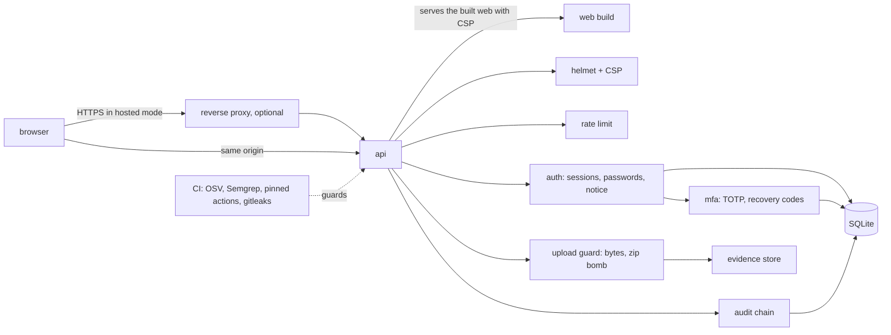
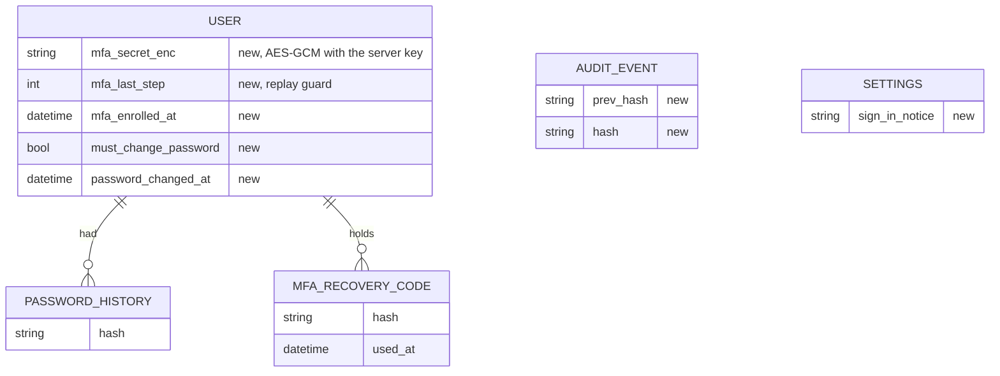

# Plan: Security hardening — Rampart as a Security Protection Asset

_Generated: 2026-11-26 · Status: active · Grilled-with: pod (fast)_

Port base: 3200
<!-- autopilot-run: started=2026-11-26T09:30:00-08:00 sprints=0 waves=0 -->

## Goal
Harden Rampart to the standard its own users are assessed against. The human chose to treat Rampart as a **Security Protection Asset** (Q8), so the tool itself meets the NIST SP 800-171 requirements it touches:
- MFA for every user
- session controls
- a password policy
- a sign-in notice
- audit integrity

It also closes the web-app gaps from the research: access-control regression tests, supply-chain checks, CSP on the served HTML, rate limits and upload hardening. Everything stays local-first, with a `HOSTED=true` mode ready for the parked deployment.

## Why
- **Research:** [security-hardening](../research/security-hardening.md) (OWASP Top 10 2025, ASVS 5.0, NIST 800-63B-4, the OWASP session cheat sheet, pnpm supply-chain guidance, @fastify/rate-limit, helmet, file-type, otplib, and the CISO Assistant and Vanta postures). Its top practice is access control first. It found no peer that publishes an 800-171 self-mapping.
- **Today's gaps:**
  - helmet covers `/api` only, and the HTML comes from the Vite dev server (an open "before hosting" queue item)
  - no general rate limiting
  - uploads aren't type-checked
  - sessions run 2 h idle and 12 h absolute
  - no MFA, no reuse check, no sign-in notice, no session lock
  - the audit log is append-only but not tamper-evident
- **Success:** an assessor reading `SECURITY.md` finds each touched 800-171 requirement mapped to code and a test. Every API route has an authz, CSRF and IDOR test. CI fails on a vulnerable or unapproved dependency. The served HTML carries a strict CSP. Every user signs in with a password plus TOTP.
- **Constraints:**
  - No CUI in V1.
  - All existing tests and e2e paths stay green; the look is unchanged.
  - The human's existing account keeps working: it enrolls in MFA at next sign-in, and its password still meets the 12-character minimum.

## Scope
**In scope:**
- **Access-control regression matrix:** a generated test over every registered route that checks 401 when signed out, 403 for a wrong role, 403 without CSRF on writes, and 404 for an id from another assessment (IDOR).
- **Supply chain:**
  - pnpm `allowBuilds`, `minimumReleaseAge` and `trustPolicy` settings, with the lockfile kept frozen
  - GitHub Actions pinned to commit SHAs
  - an OSV/`pnpm audit` job that fails on high or critical findings
  - Semgrep (OSS CLI in CI) on PRs; CodeQL needs paid GitHub Advanced Security on a private repo
  - gitleaks stays
- **Production serving:**
  - `pnpm build` makes a production web build
  - `pnpm start` serves it from the API process (same origin) with a strict CSP (`default-src 'self'`, no inline script), plus HSTS (hosted only), `Referrer-Policy`, `Permissions-Policy`, `X-Content-Type-Options` and `frame-ancestors 'none'`
  - the dev server stays for development only
- **`HOSTED=true` mode:** a `__Host-` `Secure` session cookie, HSTS, `trustProxy` for a single reverse proxy, and a startup check that refuses unsafe combinations.
- **Rate limiting:** `@fastify/rate-limit` on every route, with tighter limits on sign-in, setup, MFA and password routes, alongside the existing lockout.
- **Sessions:** 30 min idle and 8 h absolute. A new session ID at sign-in and after MFA. "Sign out everywhere" on password change, MFA reset and role change.
- **Session lock (3.1.10):** after 15 min without input the page is hidden behind a lock screen until the user re-enters their password. The server session also expires at 30 min idle.
- **Passwords:**
  - 12-character minimum (unchanged)
  - a bundled offline blocklist of common and breached passwords (no network call)
  - a password-change page
  - no reuse of the last 5 passwords (3.5.8)
  - a temporary password for an admin-created user, which must be changed at first sign-in (3.5.9)
  - feedback stays obscured (3.5.11)
- **MFA (3.5.3), required for every user:**
  - TOTP (RFC 6238) using otplib, enrolled with a QR code and a manual key
  - 10 single-use recovery codes, hashed
  - replay protection (each time step is accepted once per user)
  - TOTP secrets encrypted at rest with a server key
  - existing users enroll at their next sign-in
  - an admin can reset another user's MFA (audited)
- **Sign-in notice (3.1.9):** an admin-configurable system-use notice, shown before sign-in. The user must acknowledge it, and each acknowledgement is audited.
- **Upload hardening:**
  - a strict allowlist decided by the file's real bytes: PDF, PNG, JPEG, DOCX and XLSX, plus TXT/CSV through a text check
  - SVG, HTML, executables and archives are refused
  - docx/xlsx are checked against zip bombs (entry count, expanded size, ratio)
  - filenames are sanitized
  - existing stored files aren't touched
- **Log redaction:** review and test that no password, TOTP code, recovery code, secret, cookie or CSRF token is ever logged.
- **Hash-chained audit log:** each event stores `prev_hash` and `hash` (SHA-256 over a canonical form). Existing events are chained in order by the migration. Settings › Audit log gets a **Verify audit log** check that names the first broken link.
- **FIPS (3.13.11):**
  - a `FIPS_MODE=required` startup check that fails if Node's crypto isn't in FIPS mode
  - a PBKDF2-SHA-256 password-hash option used when FIPS is required, with argon2 by default
  - SECURITY.md documents the gap
- **SECURITY.md:**
  - a disclosure policy, following CISO Assistant's
  - a STRIDE threat model of the api, web, file store and CI
  - a mapping of Rampart's own controls to each touched 800-171 requirement, with the code and test that prove it
- **Look and e2e:**
  - new screens (MFA enrollment and challenge, recovery codes, change password, lock screen, sign-in notice, verify audit log) use existing C · Inspection controls
  - e2e covers sign-in with notice, password and TOTP; enrollment; lock and unlock; and an upload refusal

**Out of scope:**
- WebAuthn and passkeys (TOTP first; parked as an idea).
- Virus scanning (ClamAV).
- A signed external audit-log export.
- A SQLite encryption extension. Encryption at rest is the host's disk encryption, documented.
- Hosting and Microsoft 365 (parked).
- SSO (parked).

## How it fits together

**Parts:**

| Part | New or changed | Where (existing folder or module) | Does |
|------|----------------|-----------------------------------|------|
| security config | new | `apps/api/src/config`, `apps/api/src/security/` | `HOSTED`, `FIPS_MODE`, the secret key, and the startup checks |
| http hardening | changed | `apps/api/src/app.ts`, `security/headers.ts`, `security/rate-limit.ts` | helmet and CSP for HTML and API, rate limits, trustProxy, production static serving of the web build |
| auth | changed | `apps/api/src/auth/*` | session timeouts and rotation, the password policy (blocklist, history, temporary password), change password, sign-in notice acknowledgement, MFA challenge |
| mfa | new | `apps/api/src/auth/mfa/` | TOTP enroll, verify and replay guard, recovery codes, admin reset, secret encryption |
| uploads | changed | `apps/api/src/files/` (evidence and policies) | byte-based allowlist, zip-bomb guard, filename sanitizing |
| audit chain | changed | `apps/api/src/audit/*` | hash chain on write, verify endpoint |
| db | changed | `apps/api/db` (migration 0006) | `user` MFA and password-policy columns, `password_history`, `mfa_recovery_code`, `settings.sign_in_notice`, audit `prev_hash`/`hash` |
| web — auth screens | changed | `apps/web/src/pages/auth`, `settings` | sign-in notice, TOTP step, enrollment with QR and recovery codes, change password, lock screen, verify audit log, admin MFA reset |
| CI | changed | `.github/workflows/pod-ci.yml`, `pnpm-workspace.yaml`, `.npmrc` | SHA-pinned actions, an OSV/audit job, Semgrep, pnpm supply-chain settings |
| tests | new | `apps/api/src/security/*.test.ts`, `e2e/security.spec.ts` | route authz/CSRF/IDOR matrix, header checks, rate limits, upload refusals, redaction |
| docs | new | `SECURITY.md`, `pod-docs/feature-details/*` | disclosure policy, STRIDE, 800-171 self-mapping |

**How they connect:**



**Main flow:** sign-in for a user with MFA.

```mermaid
sequenceDiagram
  actor User
  participant web
  participant api
  participant db
  User->>web: open Rampart
  web->>api: GET /api/session
  api-->>web: sign-in notice text
  User->>web: acknowledge notice, email + password
  web->>api: POST /api/session (rate limited)
  api->>db: argon2 verify, lockout check
  api-->>web: mfa_required (pending session)
  User->>web: 6-digit TOTP or recovery code
  web->>api: POST /api/session/mfa
  api->>db: verify TOTP, step not reused, rotate session id
  api-->>web: session cookie (__Host- and Secure when hosted)
  Note over web: 15 min without input shows the lock screen; the password unlocks it
```

**Data:** everything is in the existing SQLite file, through one additive migration (0006). The audit chain backfills existing rows in order.



## Sprint sequence

| Sprint | Goal | Status | Depends on |
|--------|------|--------|------------|
| sec-baseline | Route authz/CSRF/IDOR matrix; supply-chain CI (pinned actions, OSV/audit, Semgrep, pnpm settings); production web serving with CSP and headers; `HOSTED` mode; rate limiting; log redaction tests | planned | — |
| sec-auth | Migration 0006; sessions (30 min / 8 h, rotation, sign out everywhere); password blocklist, history, change page, temporary password; sign-in notice; session lock screen | planned | sec-baseline |
| sec-mfa | TOTP enrollment and challenge for every user, recovery codes, replay guard, encrypted secrets, admin reset; e2e sign-in path | planned | sec-auth |
| sec-integrity | Upload hardening; hash-chained audit log with Verify; FIPS_MODE check and PBKDF2 option; SECURITY.md (disclosure, STRIDE, 800-171 self-mapping); docs and e2e | planned | sec-mfa |

## Look
`Inherits plan cmmc-l2-grc: **C · Inspection**`, unchanged, with existing controls only. New screens follow the existing Setup and Sign in pages: a Sheet card on Vellum, ballooned section labels, and 16 px minimum text. The QR code is rendered as an inline SVG in Ink on Sheet, with the manual key shown in Space Mono. (default: no new look round, as in plan ssp-export-v2)
- **Draft:** `pod-docs/design-drafts/cmmc-l2-grc-look-3.html` (Inspection column)

## Key decisions
- **Core 10 plus MFA** (Q1 b, human): the research's top 10, plus TOTP MFA.
- **Local and hosted** (Q2 a, human): local behaviour is unchanged, and `HOSTED=true` turns on `__Host-` Secure cookies, HSTS and trustProxy.
- **Sessions 30 min idle, 8 h total** (Q3 a, human), plus rotation and sign out everywhere.
- **Passwords: 12-character minimum plus an offline blocklist** (Q4 a, human). The existing account stays valid.
- **Strict byte-based upload allowlist** (Q5 a, human). Existing files aren't touched.
- **Hash chain in the DB with a Verify check** (Q6 a, human). A signed export is out of scope.
- **Rampart is a Security Protection Asset** (Q8 b, human): it meets the 800-171 requirements it touches. This overrides Q7's "MFA later".
- **TOTP with recovery codes and a replay guard** (Q10 a, human). WebAuthn is later.
- **MFA required for every user** (Q11 a, human). Existing users enroll at next sign-in, and admins can reset MFA (audited).
- **Also 3.1.9 notice, 3.5.8 reuse ban, 3.1.10 session lock and 3.5.9 temporary password** (Q12, human).
- **FIPS: document now, enforce at hosting** (Q13 a, human): a `FIPS_MODE` check plus a PBKDF2 option.
- **Merge target `main`; the human pre-approved the merge** (Q9 a, human), if the plan review passes and CI is green. Migration 0006 is a one-way door, and its wave asks the human unless they pre-approve it too.
- **Production web served by the API process (default):** a single origin keeps `SameSite=Strict` and CSRF unchanged and needs no CORS.
- **TOTP secrets encrypted with AES-256-GCM (default),** keyed by `RAMPART_SECRET_KEY`. Locally, a key file is generated in `apps/api/data/` (git-ignored); in hosted mode the env var is required.
- **Lock screen after 15 min without input (default),** with the server idle limit at 30 min. Both are configurable constants.
- **Blocklist (default):** a bundled list of about 100k common passwords (from a permissive-licence source recorded in `SOURCES`), checked case-insensitively, with no network call.
- **Upload limits (default):** 25 MiB per file (unchanged). For docx/xlsx: at most 1,000 archive entries, at most 100 MiB expanded, and at most a 100:1 ratio.

## Known risks
- **Locking out the human's own account:** MFA enrollment is forced at next sign-in. Mitigations: enrollment is done in-app after a correct password, and recovery codes are shown once and must be confirmed. A CLI `pnpm admin:reset-mfa <email>` exists for local recovery (audited).
- **Migration 0006 on the live local DB:** it's additive, and the audit backfill runs in one transaction. Back up first (`rampart.pre-0006.sqlite`), as before.
- **CSP breaking the app:** Vite builds without inline scripts, and fonts are self-hosted (@fontsource). The e2e look spec runs against the production serving path to catch breakage.
- **Rate limits flaking e2e:** test config raises the limits; dedicated tests check the real ones.
- **Supply-chain settings breaking install:** `minimumReleaseAge` can block fresh releases, and `allowBuilds` must list `better-sqlite3`, `@node-rs/argon2` and esbuild. Mitigation: try them in CI on both OSes before merge.
- **Windows:** FIPS mode isn't available on standard Node builds, so `FIPS_MODE` defaults to `off` with a documented note.

## Open questions
- None blocking. Parked for later: WebAuthn, a signed audit export, virus scanning, and an assessor's confirmation of the Security Protection Asset scoping.

## Verification
- **Route matrix:** for every registered route, the generated test proves 401 when signed out, 403 for a wrong role, 403 without CSRF on writes, and 404 for a cross-assessment id. Adding a route without a matrix entry fails the test.
- **CI:**
  - the OSV/audit job fails on a known-vulnerable fixture
  - actions are pinned by SHA (a test greps the workflow)
  - Semgrep runs on PRs and fails on high-severity findings
  - install passes with the pnpm supply-chain settings on ubuntu and windows
- **Headers:** `pnpm start` serves the built web with CSP `default-src 'self'` (no `unsafe-inline` for scripts), `frame-ancestors 'none'`, `X-Content-Type-Options`, `Referrer-Policy` and `Permissions-Policy`. In hosted mode it also sends HSTS and a `__Host-` Secure cookie. The e2e header test checks all of these.
- **Rate limits:** sign-in returns 429 after the limit, with `Retry-After`. The general limit applies per client, and through trustProxy in hosted mode.
- **Sessions:** a session expires at 30 min idle and at 8 h absolute. The session id changes at sign-in and after MFA. A password change ends all other sessions.
- **Passwords:** a blocklisted password is refused ("too common"). Reusing any of the last 5 is refused. An admin-created user must change the temporary password before anything else.
- **Notice:** sign-in can't proceed without acknowledging the notice, and each acknowledgement is audited.
- **Lock:** after 15 min without input the lock screen hides the content, and only the password unlocks it.
- **MFA:**
  - every user must enroll
  - a wrong code is refused and a reused code is refused (replay)
  - each recovery code works once
  - the secret isn't readable in the DB (encrypted)
  - an admin reset forces re-enrollment and is audited
  - the human's existing account enrolls at next sign-in and keeps its data
- **Uploads:** a renamed EXE as `.pdf`, an SVG, an HTML file and a zip bomb `.docx` are each refused with a clear error. A real PDF, PNG, DOCX and XLSX are accepted.
- **Redaction:** a test signs in, enrolls and changes the password with a log capture, then asserts that no password, code, secret, cookie or CSRF value appears.
- **Audit chain:** Verify passes on a fresh and on a migrated DB. Editing one row in SQLite makes Verify name that event.
- **FIPS:** `FIPS_MODE=required` without FIPS crypto fails startup with a clear message. The PBKDF2 option hashes and verifies.
- **SECURITY.md:** it maps each touched 800-171 requirement (3.1.8, 3.1.9, 3.1.10, 3.1.11, 3.3.1, 3.3.8, 3.5.3, 3.5.7–3.5.11, 3.13.11, 3.14.x as applicable) to code and a test.
- **Regression:** all existing unit and e2e tests stay green, with e2e updated for notice and MFA sign-in. The look spec passes on the new screens at 1280 and 375 px.
- **CI:** green on the final PR.
