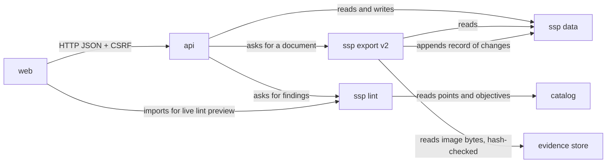
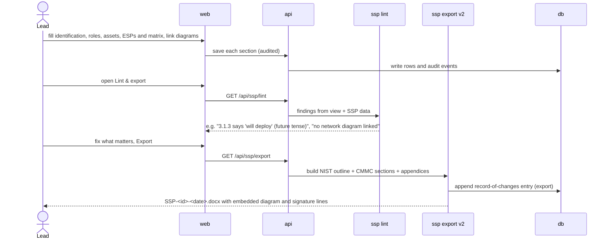
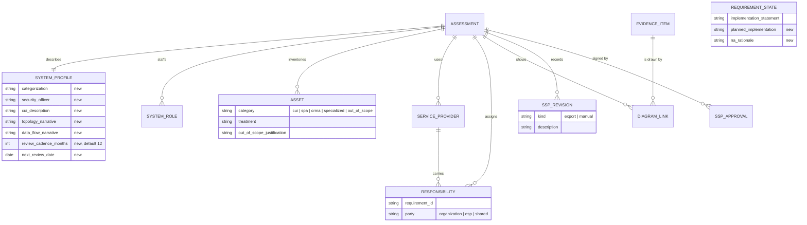

# Plan: SSP export v2 — an assessor-ready System Security Plan

_Generated: 2026-11-25 · Status: active · Grilled-with: pod (fast)_

Port base: 3200

## Goal
Turn Rampart's SSP export into a document a C3PAO or self-assessor recognizes at once. It follows NIST's own CUI SSP template outline and adds the sections 32 CFR 170.19 expects:
- an asset inventory by the five Level 2 categories
- external service providers with a customer responsibility matrix
- diagrams and CUI data flows
- roles, document control and per-objective detail

A pre-export lint shows what an assessor will catch.

## Why
- **The gap.** The research ([ssp-templates](../research/ssp-templates.md)) ranks the V1 export's gaps against 32 CFR 170.19, NDISAC and assessor guidance:
  - asset treatment by category
  - diagram and data flows
  - ESPs and a responsibility matrix
  - review cadence and revision history
  - CUI description
  - roles
  - N/A rationale
  - per-objective detail
- **The reference outline.** The orchestrator read NIST's `cui-ssp-template-final.docx` (CSRC SP 800-171 Rev 2):
  1. System identification: name, categorization, unique ID, responsible organization, system owner, system security officer, user roles and counts, admin counts
  2. System environment: topology narrative and graphic, hardware and software inventory, maintenance and ownership
  3. Requirements: Implemented / Planned to be implemented / Not applicable, with current implementation, planned implementation, and rationale if N/A
  4. Record of changes: date, description, made by
- **Success:** from a seeded assessment, one export gives a .docx in NIST's outline plus the CMMC sections and two appendices, with embedded diagram images, signature lines and an automatic record-of-changes entry. The lint panel flags each known failure pattern before export.
- **Constraints:**
  - No CUI in V1 still holds. Diagrams that contain CUI stay references and are never embedded.
  - Everything from plan `cmmc-l2-grc` stays green: 707 unit tests, 11 e2e tests, and the look.

## Scope
**In scope:**
- **System identification additions:** categorization (default "Moderate impact for confidentiality"), system security officer, responsible-organization address and phone, and a **roles** table (role, person, responsibilities, number of users). The privileged and admin count is derived from the roles table.
- **CUI description:** CUI categories (free text, referencing the CUI registry), where CUI lives, and how it enters and leaves.
- **Asset inventory:** name, category (one of the five L2 categories), type, owner, location, treatment note, and an out-of-scope justification that is required when the category is out of scope. Exported as a table grouped by category.
- **ESPs:** name, type (cloud / MSP / MSSP / other), FedRAMP or equivalent status, services, and agreement reference.
- **Customer responsibility matrix:** each requirement is *Organization / ESP / Shared*, with the ESP named and a note.
- **System environment:** a topology narrative, a CUI data-flow narrative, and **diagram links** to evidence items (caption plus version). Image files (PNG / JPG) are embedded in the .docx; other files are referenced by name, version, SHA-256 and date. CUI-flagged evidence is never embedded.
- **Hardware / software inventory reference** (narrative or URL), and a maintenance and ownership statement.
- **Per-requirement:** **Planned implementation** and **N/A rationale** fields beside the existing implementation statement. Status is derived as Met → *Implemented*, Not Met → *Planned to be implemented*, all N/A → *Not applicable*.
- **Document control:**
  - Record of changes: an automatic entry on each export, plus manual entries.
  - Review cadence: months, default 12.
  - Next review date.
  - Approvals: name, title, date, shown as signature lines in the .docx.
  - A dashboard item when the review is overdue.
- **Export v2 (.docx):** NIST outline (1–4) plus CMMC sections, then **Appendix A — Assessment status** (the SPRS, Conditional and 180-day fields moved out of the body) and **Appendix B — Assessment objectives** (each objective's status and its existing note).
- **Pre-export lint (warnings only):**
  - future-tense or aspirational statements
  - empty implementation statements
  - N/A without a rationale
  - Not Met without an open POA&M item
  - no assets, or no diagram
  - an out-of-scope asset without a justification
  - a review overdue
  - an SSP / POA&M / score mismatch
  - 3.12.4 not Met
- **`templates/` reference folder:**
  - `templates/official/`: the NIST CUI SSP and POA&M templates, the 800-171 Rev 2 and 800-171A spreadsheets, and the DoD L2 Assessment and Scoping Guides where they download.
  - `templates/SOURCES.md`: each URL, the date checked, its terms, and link-only vendor templates.

**Out of scope:**
- OSCAL SSP export (a parked idea).
- CSV import for assets.
- Email or Teams review reminders.
- Rev 3 outline (a parked idea).
- Electronic signatures: signature lines are printed only.
- Hosting and Microsoft 365 (parked ideas).

## How it fits together

**Parts:**

| Part | New or changed | Where (existing folder or module) | Does |
|------|----------------|-----------------------------------|------|
| ssp data | new | `apps/api/db` (migration 0005), `apps/api/src/ssp-data` | Roles, assets, ESPs, responsibilities, diagram links, revisions, approvals; extends system profile and requirement state |
| contract | changed | `apps/api/src/contract` | Zod schemas for the new resources and fields; new audit actions |
| ssp lint | new | `packages/rules/src/ssp-lint` | Pure function: assessment view + SSP data → ordered findings with severity and fix hint |
| ssp export v2 | changed | `apps/api/ssp` | NIST-outline model, CMMC sections, appendices, image embedding, signature lines, auto record-of-changes entry |
| web — SSP workspace | changed | `apps/web/src/pages/ssp` | Tabs: Identification & roles, Environment (narratives, diagrams), Assets, Service providers & matrix, Document control, Lint & export |
| web — requirement fields | changed | `apps/web/src/pages/assessment` | Planned implementation and N/A rationale beside the implementation statement |
| web — dashboard | changed | `apps/web/src/pages/dashboard` | "SSP review overdue" in Needs attention |
| templates | new | `templates/` | Official reference files and SOURCES.md |

**How they connect:**

**Main flow:** a compliance lead prepares and exports the SSP.

**Data:** everything is in the existing SQLite file, written only by `api`, in one additive migration (0005). Diagram files stay in the evidence store; only links are new.

## Sprint sequence

| Sprint | Goal | Status | Depends on |
|--------|------|--------|------------|
| ssp-data | Migration 0005 and contract; API for roles, CUI description, assets, ESPs and the responsibility matrix, diagram links, requirement planned/N-A fields, document control (revisions, cadence, approvals), all audited; the `templates/` folder | done | — |
| ssp-workspace | Web: SSP workspace tabs (identification and roles, environment and diagrams, assets, service providers and matrix, document control); planned and N/A fields in the assessment workspace; dashboard "review overdue" | active | ssp-data |
| ssp-export-lint | The lint rules package and `GET /api/ssp/lint`, with a live lint panel; export v2 in NIST outline plus CMMC sections plus Appendices A and B, embedded images, signature lines and the automatic record-of-changes entry; e2e and Look updates | planned | ssp-workspace |

## Look
`Inherits plan cmmc-l2-grc: **C · Inspection**`, unchanged. It uses the same six tokens, fonts, controls and layout rules (C's ruler, GO / NO GO chips, ballooned section labels, 16 px minimum, red text at body size only on Sheet). The new screens use existing controls only: TextField, TextArea, Select, RadioGroup, Checkbox, FileField, Alert, StatusChip, SectionLabel, plus tables in the existing card style. Lint findings use Alert (error tone for errors, info for warnings) and cite the requirement. (default: no new look round — the human chose Q13 a)
- **Draft:** `pod-docs/design-drafts/cmmc-l2-grc-look-3.html` (Inspection column; ruler from the Spec Sheet column)

## Key decisions
- **NIST outline first** (Q2, human): the body follows NIST's `cui-ssp-template-final.docx`. The tool-specific SPRS / Conditional / 180-day data moves to Appendix A.
- **Structured, not free text** (Q3, Q4, Q6, human): the asset inventory with the five 32 CFR 170.19 categories, ESPs with a customer responsibility matrix, and a roles table.
- **Diagrams** (Q5, human): link evidence items. Embed PNG / JPG in the .docx and reference other types. **Never embed CUI-flagged evidence**; the V1 no-CUI rule stands.
- **Requirement status in NIST terms** (Q7, human): Implemented / Planned to be implemented / Not applicable, derived from objective status, with new Planned implementation and N/A rationale fields.
- **Document control** (Q8, human): an automatic record-of-changes entry on each export, manual entries, a 12-month default cadence, approvals printed as signature lines, and a dashboard item when overdue.
- **Appendix B** (Q9, human): per-objective status and the existing objective notes. No new per-objective field.
- **Lint warns, never blocks** (Q10, human).
- **`templates/` folder** (Q11, human): official NIST and DoD files are committed where they download, with terms and dates in `templates/SOURCES.md`; vendor templates are linked only. If the DoD guides refuse a download (403), they are linked and noted.
- **OSCAL later** (Q12, human).
- **Look inherited** (Q13, human).
- **Merge target `main`:** reuses `decisions.md` "2026-11-23 — merge target: default branch".
- **Migration 0005 additive only (default)**, with no changes to existing columns. Note: a plan that adds a migration has its final PR withheld for the human by policy.
- **Lint in `packages/rules` as a pure function (default)**, so the web panel and the API agree, as the score does.
- **Future-tense detection is a small versioned word list (default):** "will", "plan to", "planned", "intend", "going to", "to be implemented", "TBD". It is matched case-insensitively on word boundaries, and the list is data, so it can be tuned.
- **Image embedding (default):** PNG and JPG only, scaled to page width, with the caption from the link. Any other type is referenced.

## Known risks
- **Migration on a live local DB:** the human's app uses `apps/api/data/rampart.sqlite`. Mitigation: additive only, plus a test that a 0004 database upgrades with all rows kept. After merges, re-install and restart the parent checkout (a known issue).
- **Large images bloat the .docx:** evidence is capped at 25 MiB. Mitigation: embed at most N images (default 10) and reference the rest, and the lint warns when an image is very large.
- **Template licensing:** the NIST files are probably US government work, but unverified. Mitigation: `SOURCES.md` records terms and dates, and nothing vendor-made is redistributed.
- **The DoD guides may 403 on automated download:** they are linked instead, and the slice records it.
- **Look regressions on denser tables at 375 px:** the e2e look spec covers every route. New tables stack into cards at phone width.

## Open questions
- None blocking. The human may later want CSV asset import, OSCAL, or e-signatures; all are out of scope.

## Verification
- **Migration 0005:** a database at 0004 with data upgrades to 0005 with every row kept, and `drizzle-kit check` passes.
- **Section persistence:** every new section can be created, edited and read back after a restart, and every change appears in the audit log with before and after.
- **Lint:** unit tests cite a fixture for each rule (future tense, empty statement, N/A without rationale, Not Met without a POA&M, no assets, no diagram, out-of-scope without justification, review overdue, SSP / POA&M / score mismatch, 3.12.4 not Met), and the web panel and `GET /api/ssp/lint` return the same findings.
- **Export:** `GET /api/ssp/export` on a seeded assessment returns a .docx whose `word/document.xml` has, in order:
  - "1. System identification" (with the roles table)
  - "2. System environment" (narratives, an **embedded image** for a PNG diagram link, a reference line for a PDF diagram)
  - the CMMC sections: CUI description, asset inventory grouped by the five categories, ESPs and the responsibility matrix
  - "3. Requirements" (each with Implemented / Planned / Not applicable, current implementation, planned implementation, N/A rationale)
  - "4. Record of changes", including the automatic entry for this export
  - signature lines for each approval
  - Appendix A (SPRS, Conditional, 180-day)
  - Appendix B (objectives)

  A CUI-flagged diagram is never embedded.
- **Dashboard:** it shows "SSP review overdue" when the next review date has passed.
- **`templates/`:** the folder exists, every committed file is listed in `SOURCES.md` with its URL, date checked and terms, and the vendor templates are links only.
- **Tests and look:** all existing tests and e2e still pass. The e2e smoke path is extended to fill the new sections and assert the v2 export headings. The look spec passes on the new routes and tabs at 1280 and 375 px.
- **CI:** green on the final PR (verify and e2e on ubuntu and windows, plus gitleaks).
